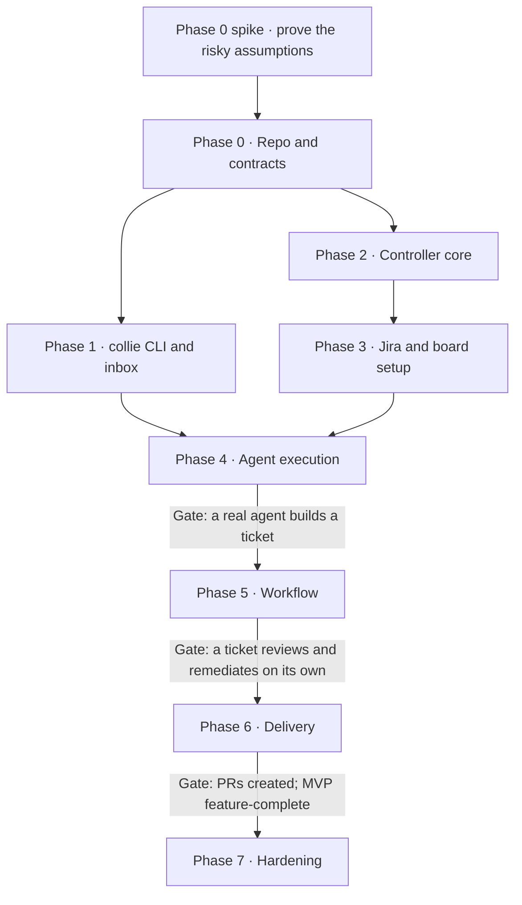

# Herdr Collie — Phased Implementation Plan

## Decisions to settle before Phase 0

Eight choices shape every phase after them. Each row has a recommendation; change any you disagree with before the first agent starts.

| Decision | Recommendation | Why | Alternative |
| --- | --- | --- | --- |
| Language for CLI and controller | TypeScript on Bun, CLI compiled to one binary | The mod is TypeScript, so schema types are shared by all three parts; one toolchain | Go: a fast static CLI, but types live in JSON Schema and are generated twice |
| Repo layout | One repo: `packages/schema`, `packages/cli`, `packages/controller`, `mod/`, `fixtures/`, `tools/` | Contracts change in one commit with their users | Separate repos per part |
| Harnesses in the MVP | Claude Code first, a second harness in Phase 7 | One harness keeps idle detection and `hc send` behaviour to one set of quirks | All harnesses from Phase 4 |
| Jira auth | API token from the OS keychain | Simple, works locally | OAuth app |
| Code host | **Bitbucket Cloud only**, through the REST API (`api.bitbucket.org/2.0`) with a repository, project or workspace access token from the OS keychain, sent as a Bearer token; pushes over HTTPS with the same token | Matches where your repos live; no extra CLI dependency | GitHub and others later, behind a host interface |
| Testing herdr-core | A fake `hc` shim plus a fake agent script; real-hc tests opt-in | Most phases become testable without Herdr or a model | Real hc only, slower and flaky |
| Who starts the controller | The mod, via `hc run` with label `collie.role=controller`, when no live lock exists | No extra setup for you | A manual command or login item |
| Dependency graph view | **Built from scratch** in the Collie mod: layered layout, critical path, external blockers | Designed around Collie's states and agent chips from the start | Reuse an existing DAG mod |

## How the implementing agent works

One phase per agent session, ending in a reviewed PR and a hand-off report that becomes the next phase's input.

**Inputs for every phase**, committed to the repo so the agent can read them:

- `docs/plan.md`: this plan.
- `docs/protocol.md`: the reporting protocol, data shapes, state machines, agent templates and retention rules.
- `docs/wireframes/`: one PNG per wireframe screen.
- `docs/herdr/`: Herdr's `AGENTS.md`, `herdr.d.ts` and `gpui-kit.d.ts`.
- `docs/handoff/phase-N.md` from every earlier phase.

**Rules**

1. Build only what the phase lists. Anything else goes in the hand-off report as a suggestion.
2. Contracts come from `packages/schema`. A schema change needs a note in the report and updated fixtures.
3. Write tests with the code. Every "Done when" item maps to at least one automated test, or to a demo step when it needs real Herdr.
4. When the spec is ambiguous, pick the simplest reading, mark it `DECISION:` in the code, and list it in the report. Stop and ask only when a choice can't be undone cheaply.
5. `make check` (lint, types, tests) is green before the PR.

**Hand-off report** (`docs/handoff/phase-N.md`): what was built, deviations from the spec and why, `DECISION:` items, known gaps, and the exact commands to run the phase demo.

**Kick-off prompt**

```markdown
Implement Phase N of Herdr Collie.
Read docs/plan.md (Phase N and the rules), docs/protocol.md,
and every report in docs/handoff/. Build only Phase N's scope.
Finish when every "Done when" item passes, make check is green,
and docs/handoff/phase-N.md is written. Then open a PR.
```

## Phase map



Phases 1 and 2 can run as two agents at once; everything after Phase 4 is sequential, and each gate is worth a manual check before the next phase starts.

## Phase 0 spike — prove the risky assumptions

Before Phase 0 builds anything, spend a day or two proving the five assumptions the design rests on, with real Herdr, Claude Code and Bitbucket Cloud. The code is throwaway; the findings are not.

| Assumption | How to prove it | If it fails |
| --- | --- | --- |
| `hc send` delivers a message to an idle Claude Code session and submits it | Launch Claude Code with `hc run`, send text with `hc send`, confirm with `hc read` that it arrived as a user turn. Also send mid-turn and record what happens. | Find the submit sequence the adapter must send, or switch answers to a file the agent polls |
| Herdr's agent status reliably shows when a Claude Code turn ends | Run turns with tool calls, long commands and questions; log status changes and their delay | Add `hc read` polling to the harness adapter |
| Environment variables and labels from `hc run` reach the agent's own shell commands | Have the agent run `env` and `collie`-like commands; check `COLLIE_INBOX` is visible | Pass identity in a file in the worktree instead of the environment |
| gpui-kit can draw the dependency graph well enough | A throwaway mod drawing 20 nodes with edges, selection and scrolling | Simplify to a grouped list with "blocked by" annotations for the MVP |
| Bitbucket Cloud supports the PR operations Phase 6 needs | On a scratch repo with an access token: create a draft PR, change its destination branch, mark it ready, read approvals and conflict state | Adjust the draft policy and stack upkeep to what the API allows |

**Done when**

- [x] `docs/spike.md` records a yes or no for each assumption, with evidence.
- [x] Every "no" has an agreed change to this plan or the protocol doc before Phase 0 starts.

**Outcome (2026-11-09).** Every assumption held. Each came with conditions, and two needed design
changes: agents must be launched with `--no-parent`, and PR conflict state has to be computed
locally. A sixth check, the Jira scoped token, was added. All eleven proposed changes (C1–C11 in
`docs/spike.md`) were accepted and are folded into this plan and `docs/protocol.md`. Before
Phase 0: if Herdr has been updated past the snapshot in `docs/herdr/VERSION` (Herdr 0.1.14 and
herdr-core 0.1.19 were on offer during the spike), re-sync `docs/herdr/` in its own commit first.

## Phase 0 — Repo, contracts and fixtures

Every later phase builds against fixed, tested contracts and fakes, so Phases 1 and 2 can run in parallel.

**Builds**

- The repo layout from the decisions table, with lint, typecheck, test and `make check`.
- `packages/schema`: the envelope, agent events, controller events, `ctl` commands and state shapes from the protocol doc, as types plus runtime validators, and a `SCHEMA_VERSION` constant.
- `fixtures/`: valid and invalid inbox lines for every agent event type, and an `events.jsonl` covering one complete run.
- `tools/fake-hc`: a shim for `hc run`, `send`, `ls`, `kill`, `wait` and `label` that follows a scenario file and logs every call.
- `tools/fake-agent`: a script that runs `collie` commands from a scenario file, to stand in for a real harness.
- `docs/adr/`: one short record per decision in the table above.

**Not in this phase:** any `collie` command, the controller, the mod.

**Done when**

- [x] Every valid fixture passes validation, and every invalid one fails with a message naming the field.
- [x] The fake `hc` logs its calls and plays back a scripted agent status sequence.
- [x] `make check` is green in CI.

## Phase 1 — `collie` CLI and inbox

Agents can report everything the protocol defines, and bad calls fail with a message that tells the agent how to fix them.

**Builds**

- Agent commands: `status`, `finding`, `artifact`, `ask`, `done`, `fail`, and `show task`, `show findings`, `show answers`.
- Environment handling (`COLLIE_INBOX`, `COLLIE_RUN_ID`, `COLLIE_EXECUTION_ID`, `COLLIE_TICKET`, `COLLIE_ROLE`, `COLLIE_HOME`).
- Inbox writes: `flock`, one `write()` per line, ULID ids, retry with the same id.
- `--body-file` and stdin; bodies over 64 KB moved to `attachments/`.
- Role checks and local checks: a developer's `done` refuses a dirty worktree or no commits ahead of base; a reviewer's `done` needs a verdict.
- Exit codes 0, 2, 3, 4 and 5, `--json` output, and `--help` that fits on one screen.
- A single compiled `collie` binary.

**Not in this phase:** `collie ctl` (Phase 2); anything that reads the inbox.

**Done when**

- [x] 20 parallel `collie finding` calls produce exactly 20 intact lines.
- [x] Each invalid fixture's equivalent call exits 2 with a fix-it message.
- [x] `done` in a dirty worktree exits 2; any write after `done` or `fail` exits 4; a missing environment exits 3.
- [x] The `show` commands print from fixture files.
- [x] A fake-agent scenario writes an inbox identical to its expected fixture, apart from ids and timestamps.

## Phase 2 — Controller core

A controller that owns runs, survives being killed, and processes inboxes, with no Jira, Herdr or real agents yet.

**Builds**

- `collie-controller` entry point; `controller.lock` with stale-lock detection (dead pid).
- The `~/.collie` storage layout; atomic writes (temp file, then rename) for every JSON file.
- Boards loaded from JSON (Jira arrives in Phase 3).
- Run lifecycle: start (with config snapshot), pause, resume, cancel, complete.
- `events.jsonl` writer, `state.json` materialiser, and a rebuild of state from events.
- Ticket leases.
- The control channel (`control/pending`, `control/done`) and `collie ctl` for board, run, answer, exec, dep and ticket commands. Commands that need later phases return a clear "not yet supported".
- Inbox watcher: byte offsets, incomplete-line handling, de-duplication by id, `agent.event_accepted` and `agent.event_rejected`.
- Recovery on start, without Herdr reconciliation (Phase 4).

**Not in this phase:** scheduling, launching agents, Jira, the mod.

**Done when**

- [x] Killing the controller with `kill -9` mid-run and restarting it gives the same state as a rebuild from `events.jsonl`.
- [x] A second controller refuses to start while the first holds the lock.
- [x] Starting a run on a ticket leased by another run is refused with a clear reason.
- [x] `collie ctl` exits 6 within 10 seconds when no controller is running.
- [x] A fixture inbox produces exactly the expected accept and reject events, including a duplicate id and a write after `done`.

## Phase 3 — Jira, dependency graph and board setup

You can build a board from real Jira tickets in Herdr and see its correct dependency graph before any agent runs.

**Builds**

- Jira client: auth per the decisions table, import by keys or JQL, recorded HTTP fixtures for tests.
  - Every call goes through `https://api.atlassian.com/ex/jira/{cloudId}/rest/api/3/…` with Basic `email:token`. A scoped token is rejected on the site URL.
  - `cloudId` comes from `https://[SITE].atlassian.net/_edge/tenant_info` at board creation and is cached as `jira.cloud_id`.
  - Search with `POST /search/jql` and `nextPageToken` pagination (there's no `total`), asking for `summary`, `status`, `resolution` and `issuelinks`. Links carry the other issue's status, so external blockers need no extra calls.
- Credentials: the keychain item's account field holds the Jira email. If more than one item has a Collie service name (`collie-jira`, `collie-bitbucket`), refuse to continue and name the accounts found. A 401 with `x-failure-category: FAILURE_CLIENT_AUTH` gets an error that says to check the email in the account field and the token.
- Dependencies from issue links, where only blocks / is-blocked-by affect order; external-blocker detection; cycle detection. Direction: on issue A, a `Blocks` link with `outwardIssue: B` means A blocks B, and `inwardIssue: B` means B blocks A. Confirm this with the first recorded fixture, taken from two real test issues linked by hand.
- Completion policy (done only, done or resolved, done or testing, custom mapping) and readiness calculation.
- Preparation statuses, set by hand in this phase.
- `ctl` commands: board create and import, pull in a blocker, override a dependency, exclude a ticket.
- Graph view, built from scratch in the mod: a layered left-to-right layout computed from the DAG, ticket nodes with state and room for agent chips, edges for blocks, a critical-path highlight, external blockers drawn dashed, and selection that opens a ticket. Keep layout in a pure function with unit tests, separate from rendering.
- Mod: the Collie tab shell (header, view tabs) and the Board setup screen (wireframe 4).
- Mod ↔ controller wiring: commands through `exec("collie", ["ctl", …])`, state through watching `~/.collie`; the mod starts the controller if no live lock exists.

**Not in this phase:** the requirements analyst (Phase 5); starting runs from the UI (Phase 4); drag-to-pan in the graph (after the MVP; scrolling is enough, per the spike).

**Done when**

- [x] Importing five tickets with known links produces the expected graph.
- [x] Layout unit tests place every fixture board with no overlapping nodes and no edge crossing a node.
- [x] A cycle is reported and blocks Start run.
- [x] A blocker outside the board shows Pull in and Override, and both work.
- [x] Readiness changes when a blocker's Jira status changes and you refresh.
- [x] Reloading the mod shows the same board without data loss.

## Phase 4 — Agent execution

The first end-to-end milestone: a run dispatches a real developer agent per ready ticket, each in its own worktree and Herdr terminal, and you can watch it in Collie.

**Builds**

- Agent profiles as JSON files (the editor UI comes in Phase 7).
- Worktree per ticket, following Herdr's `~/.herdr/worktrees/<repo>/<branch>` convention.
- Launch through `hc run` with the environment, `collie.*` labels and `task.md`, exactly as in the protocol's *Launching an agent*:
  - `--no-parent --no-notify`
  - an `env` argv wrapper for the `COLLIE_*` variables
  - the `claude-code` adapter's rules: an absolute `claude` path, `CLAUDE_CODE_DISABLE_BACKGROUND_TASKS=1`, and the first message before the options
- Turn-end detection and sends per the protocol's *Talking to an agent*:
  - `idle` and `done` both mean the turn ended, observed with `hc wait <terminal>`
  - `hc send` only then, with `HC_TERMINAL_ID` unset, never `--if idle` or `--force`
  - exit codes 9 and 10 mean retry later
  - `blocked` is recorded with its kind
- A developer-only workflow: dispatch ready tickets within the ticket and agent limits.
- Scheduler priority: critical path, then most downstream work unblocked, then longest waiting.
- Execution lifecycle: idle-without-report nudges, timeouts, exit without a report, retries.
- Herdr reconciliation on controller restart, matched by `collie.execution` label.
- Mod: Start, Pause and Cancel run; the live Delivery graph (wireframe 1, PR panel empty); the ticket inspector (wireframe 2) with the execution list and the agent's live terminal.

**Not in this phase:** reviewers, questions, PRs.

**Done when**

- [ ] With fake `hc`: a three-ticket run with one dependency completes, and the blocked ticket starts only after its blocker is done.
- [ ] With real Herdr and Claude Code: one ticket in a scratch repo reaches developer done with a commit on its branch.
- [ ] An agent that goes idle without reporting is nudged twice, then failed as retryable.
- [ ] Restarting the controller mid-run reattaches to the running agent without starting a duplicate. The agent's terminal survives the controller's terminal being killed.
- [ ] Reloading the mod mid-run loses nothing.

## Phase 5 — Workflow: reviews, remediation, questions

A ticket goes through the full default workflow on its own, and stops only to ask you something.

**Builds**

- Workflow definitions: Standard feature (default) and Small bug fix, chosen per board and per ticket.
- Parallel reviewers dispatched after a developer's `done`, read-only in the developer's worktree.
- Findings aggregation, with reviewer verdict rules and a gate on all required reviews.
- Remediation: the developer is relaunched with `collie show findings`; reviewers re-run; rounds capped, then Needs input.
- Questions end to end: `ask` → Needs input → `collie ctl answer` → `hc send` when the agent is idle → `question.delivered`.
- Herdr notifications for Needs input and run completion.
- Requirements analyst during board setup: it investigates tickets, sets their preparation status, and raises questions.
- Mod: the question dialog (wireframe 3), the Needs you banner, and the Findings and Questions tabs.

**Not in this phase:** pushing branches, PRs, Jira write-back.

**Done when**

- [ ] A reviewer's blocking finding triggers one remediation round, after which the reviewer approves and the ticket passes the gate.
- [ ] Hitting the round cap moves the ticket to Needs input instead of looping.
- [ ] An answered question reaches the waiting agent, which continues the task.
- [ ] The analyst marks an under-specified ticket Needs input with its questions.

## Phase 6 — Delivery: PRs and Jira

Finished tickets become correctly based pull requests, and Jira reflects their progress.

**Builds**

- A `CodeHost` interface (create PR, update PR, get PR status, retarget, mark ready) with one implementation: Bitbucket Cloud's REST API at `api.bitbucket.org/2.0`, authenticated with an access token from the keychain as a Bearer token. GitHub can be added later behind the same interface.
- Token scopes checked on start from a `GET` of the repository: read `x-credential-type` and `x-oauth-scopes`. `pullrequest:write` alone is enough, because it includes `repository:write`. A missing scope fails the run before any agent starts, naming the scope.
- Recorded HTTP fixtures for every Bitbucket call the controller makes, so tests never hit the network.
- Branch base rule, decided when the worktree is created: base on the default branch, unless a blocker is still unmerged, in which case base on the blocker's branch and record a Git dependency.
- After the gate passes: verify commits, push over HTTPS with the token supplied per command (never stored in the remote URL), and open a PR with a description built from the ticket and a findings summary. The push is `GIT_TERMINAL_PROMPT=0 git -c credential.helper= -c 'credential.helper=!<inline helper that reads the keychain>' push <https url> <ref>`, with username `x-token-auth`. The empty first `credential.helper=` stops any configured helper from saving the token.
- A board setting, **PR draft policy**, shown in the Board setup run settings and snapshotted with the run:
  - *Draft when stacked* (default): a PR targeting the default branch opens ready for review; a PR stacked on an unmerged parent opens as a draft.
  - *Always draft*: every PR opens as a draft, for teams where you review agent PRs before anyone else does.
- PR tracking by polling the API: approvals, merged or declined. Approvals ignore the PR author's own entry; Collie never calls `approve`.
- Merge conflicts aren't in Bitbucket's API (the spike found no field, and `merge=true` diffstat returns 410). Each poll, fetch the destination branch and run `git merge-tree --write-tree <destination> <source>`: exit 1 means conflicted, and the result is logged as `pr.conflict_checked`. Requires git 2.38 or later, checked on start.
- Stack upkeep: when a parent PR merges, flag children for rebase and change their destination branch. Under *Draft when stacked*, a child whose destination is now the default branch is marked ready automatically.
- Jira write-back per the board's policy: transitions plus a comment linking the PR. The policy names target statuses. Each write lists the issue's transitions, picks the one whose `to.name` matches (an exact transition `name` wins over others), and logs `jira.writeback_skipped` with the available targets when none matches.
- Ticket completion levels: implementation done, PR created, PR approved, merged; the board chooses which one counts as complete for its dependents.
- Mod: the Pull requests panel (wireframe 1, right side) with a **Mark ready** action on draft PRs, and PR rows in the ticket inspector.

PR tracking continues after a ticket completes, and after its run ends, until each PR is merged or declined. Stack upkeep depends on it, because with `complete_at` before merge, parents usually merge after their tickets are done.

**Not in this phase:** GitHub or other hosts, cross-repo tickets, automatic rebasing.

**Done when**

- [ ] Two dependent tickets produce stacked Bitbucket PRs with the correct destination branches; an independent ticket's PR targets the default branch.
- [ ] Under *Draft when stacked*, the independent PR opens ready for review and the stacked one as a draft; under *Always draft*, both open as drafts.
- [ ] Merging the parent PR flags the child for rebase, retargets it, and, under *Draft when stacked*, marks it ready.
- [ ] Mark ready in the PR panel publishes a draft PR.
- [ ] Jira transitions and comments appear in a test project as the policy says.
- [ ] The Bitbucket token never appears in `events.jsonl`, logs, agent environments or Git remote URLs saved to disk.

## Phase 7 — Hardening and MVP acceptance

The MVP is complete when the MVP acceptance scenario below passes as an automated test and once by hand.

**Builds**

- Mod: the Activity view and run history (wireframe 6), New run from a previous run, and the agent profile editor (wireframe 5).
- Retry and cancel controls for executions and tickets throughout the UI.
- A second harness profile (Codex or your choice).
- Run metrics: tickets completed without intervention, interventions per ticket, time to PR, remediation success.
- Docs: README, setup guide, and the agent instructions block Collie appends to every profile.
- The MVP acceptance scenario as an end-to-end test on fake `hc`, fake agents and recorded Jira and Bitbucket responses, plus a manual checklist for the real run.

**Done when**

- [ ] The end-to-end scenario passes in CI.
- [ ] A manual run on a real Jira board with five tickets reaches PRs, with every step checked off the manual list.
- [ ] The retention rules from the protocol doc are implemented: the daily prune pass, worktree removal that never loses unpushed work, terminal cleanup, and `run.delete`.

## MVP acceptance scenario

The MVP is done when this scenario passes end to end, twice: automated in CI with fake `hc`, fake agents and recorded Jira and Bitbucket responses, and once by hand with real Herdr, Claude Code, a scratch Jira project and a scratch Bitbucket Cloud repository.

Board settings for the run: the Standard feature workflow, **Draft when stacked**, and `complete_at` set to **PR created**, so a dependent ticket can start, and be stacked, before its blocker's PR merges.

**Setup**

1. Create a board linked to the Jira project and the Bitbucket Cloud repository. The token scope check passes.
2. Import five tickets by JQL.
3. Collie draws their dependency graph, including one blocker that isn't on the board.
4. Pull in the outside blocker. The graph and readiness update.
5. Run the requirements analyst. It marks one ticket Needs input with a question; you answer it, and the ticket becomes Ready.

**Execution**

6. Start the run. Tickets are leased and the configuration is snapshotted.
7. Independent tickets start concurrently, each in its own worktree and Herdr terminal. A ticket with an unfinished blocker stays Blocked.
8. Each running agent appears in Herdr's sidebar, and its live terminal opens from the ticket inspector.
9. A developer calling `collie done` with uncommitted changes is refused; it commits and reports again.
10. A finished developer triggers the workflow's reviewers in parallel.
11. One reviewer asks a question. The ticket moves to Needs input and Herdr notifies you.
12. You answer in the question dialog. The answer is delivered when the agent is idle, and it continues.
13. A reviewer requests changes with a blocking finding. One remediation round runs, the reviewer re-runs, and approves.
14. An agent that goes idle without reporting is nudged twice, then failed and retried automatically.

**Delivery**

15. An independent ticket's branch is pushed and its Bitbucket PR opens ready for review, targeting the default branch.
16. A dependent ticket, started while its blocker's PR was still open, is based on the blocker's branch. Its PR opens as a draft targeting that branch.
17. Jira tickets move to the configured statuses, with a comment linking each PR.
18. Downstream tickets start as soon as their blockers reach PR created.
19. You merge the parent PR in Bitbucket. Collie retargets the child PR to the default branch, flags it for rebase, and marks it ready for review.

**Resilience and completion**

20. Reloading the Collie mod mid-run loses nothing.
21. Killing the controller mid-run and restarting it reattaches to the running agents without starting duplicates.
22. The run completes when every ticket is completed, and the Activity view shows its full event history.
23. The Bitbucket token appears nowhere in `~/.collie`, logs, agent environments or saved Git remote URLs.
